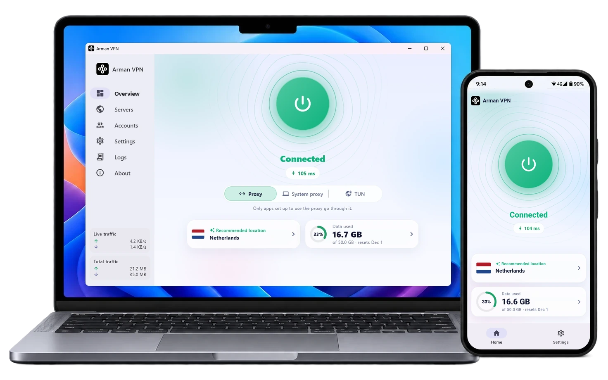
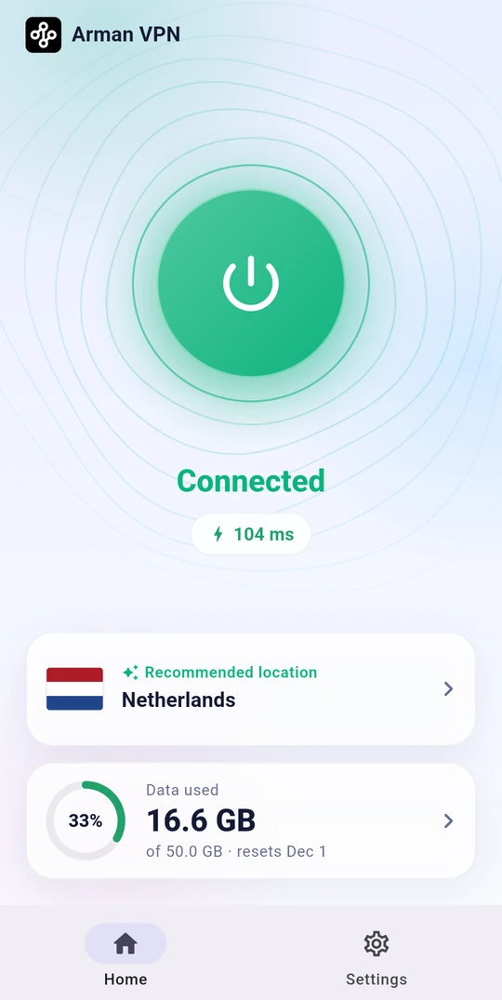
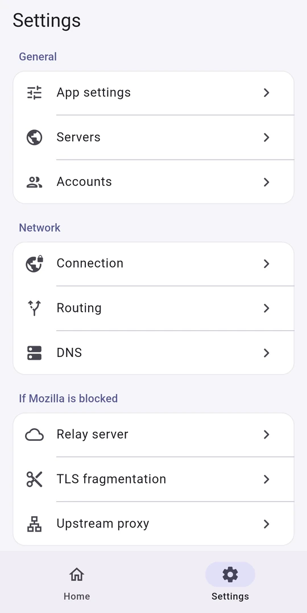
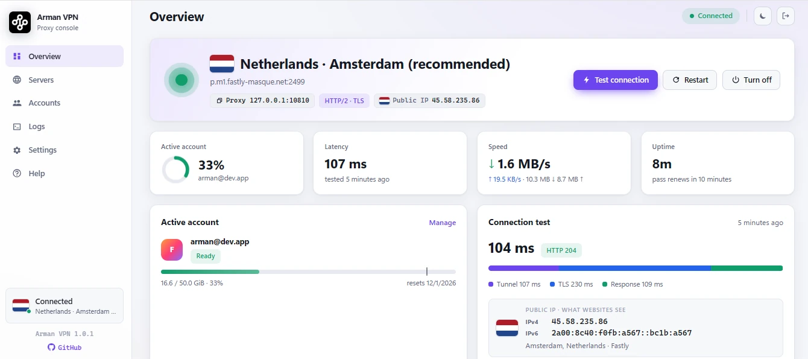

<div align="center">

**🇺🇸 English** &nbsp;/&nbsp; [🇨🇳 简体中文](docs/readme/README_zh.md) &nbsp;/&nbsp; [🇷🇺 Русский](docs/readme/README_ru.md) &nbsp;/&nbsp; [🇮🇷 فارسی](docs/readme/README_fa.md)

</div>
<br>

<p align="center"></p>

<h1 align="center">Firefox VPN</h1>

<div align="center">

[](https://github.com/armanlife/firefox-vpn-client/releases)
[](https://github.com/armanlife/firefox-vpn-client/releases/latest)
[](LICENSE)

</div>

## What is Firefox VPN?

**Firefox VPN** is a free, open-source VPN that works with a Firefox Account. It carries your internet traffic through Mozilla's servers, on **Fastly**'s infrastructure, over secure **HTTP/2 and HTTP/3** tunnels.

Every Firefox Account comes with **50 GB of free data a month**, and the **multi-account** feature multiplies it: when one runs out, the next connects **automatically**.

For **Android, Windows, macOS, and Linux**; completely free, with no ads.

<p align="center"><a href="https://raw.githubusercontent.com/armanlife/firefox-vpn-client/main/docs/screenshots/main.webp" target="_blank"></a></p>

## 🚀 Main features

✈️ Cross-platform: Android, Windows, macOS, and Linux

📺 Android TV: works with the remote control

⭐ Very easy to use, with a simple interface

🆓 Free: 50 GB a month for every Firefox Account

➕ Multi-account: when one account's data runs out, the next takes over automatically

🌐 Mozilla's official servers: choose a country with a ping test, or let the app pick the best server

⚡ Fast, stable connections over HTTP/2 and HTTP/3

🔀 Smart routing: local sites open directly, faster and without using data

🧱 If Mozilla is blocked: TLS fragmentation, upstream SOCKS5 proxy, and a relay server

🔒 Encrypted DNS (DNS over HTTPS)

🌍 15 languages, including English, Persian, Chinese, and Russian

🌙 Light and dark themes

🛡 Open source, secure, and community-driven

🔄 Automatic updates

## 📸 Screenshots

<p align="center">
&nbsp;&nbsp;
&nbsp;&nbsp;

</p>

## 📥 Download

<table>
<thead>
<tr><th>System</th><th>Download</th></tr>
</thead>
<tbody>
<tr><td>Android</td><td><a href="https://github.com/armanlife/firefox-vpn-client/releases/latest/download/Firefox-VPN-Android-universal.apk"></a><br><a href="https://github.com/armanlife/firefox-vpn-client/releases/latest/download/Firefox-VPN-Android-arm64-v8a.apk"></a><br><a href="https://github.com/armanlife/firefox-vpn-client/releases/latest/download/Firefox-VPN-Android-armeabi-v7a.apk"></a><br><a href="https://github.com/armanlife/firefox-vpn-client/releases/latest/download/Firefox-VPN-Android-x86_64.apk"></a></td></tr>
<tr><td>Android TV</td><td><a href="https://github.com/armanlife/firefox-vpn-client/releases/latest/download/Firefox-VPN-Android-universal.apk"></a></td></tr>
<tr><td>Windows</td><td><a href="https://github.com/armanlife/firefox-vpn-client/releases/latest/download/Firefox-VPN-Windows-Setup-x64.exe"></a><br><a href="https://github.com/armanlife/firefox-vpn-client/releases/latest/download/Firefox-VPN-Windows-x64.zip"></a></td></tr>
<tr><td>macOS</td><td><a href="https://github.com/armanlife/firefox-vpn-client/releases/latest/download/Firefox-VPN-macOS.dmg"></a></td></tr>
<tr><td rowspan="2">Linux</td><td><a href="https://github.com/armanlife/firefox-vpn-client/releases/latest/download/Firefox-VPN-Linux-amd64.tar.gz"></a><br><a href="https://github.com/armanlife/firefox-vpn-client/releases/latest/download/Firefox-VPN-Linux-arm64.tar.gz"></a></td></tr>
<tr><td><a href="https://github.com/armanlife/firefox-vpn-client/releases/latest/download/firefox-vpn-core-linux-amd64.tar.gz"></a><br><a href="https://github.com/armanlife/firefox-vpn-client/releases/latest/download/firefox-vpn-core-linux-arm64.tar.gz"></a></td></tr>
</tbody>
</table>

**Which file should I download?**

- **Android:** if you are not sure, take **Universal**; it installs on every phone. **ARMv8** is for most of today's phones and is smaller.
- **Windows:** **Setup** is a normal installer; **Portable** needs no install and runs from any folder.
- **Linux:** **App** for a Linux desktop (with a graphical environment); **Core** for a server (without a graphical environment, with a web panel).

## 💻 Install and update on Linux and macOS

> Windows and Android users don't need this section: take the installer from the "Download" table above.

```bash
curl -fsSL https://raw.githubusercontent.com/armanlife/firefox-vpn-client/main/install.sh | bash
```

### 🌐 Web panel

For Linux servers, Firefox VPN has a **web panel** that opens in any browser and has everything the app has: managing accounts and data, choosing a server and testing delay, the connection test, the live log, and every setting.

<p align="center"></p>

- **Panel address:** `http://SERVER-IP:10820/app/`, with a username and password. The exact address is shown at the end of the install.
- **Proxy:** SOCKS5 and HTTP on port `10810`, with a username and password of its own.

### ⌨️ Managing from the terminal

On the server, run `sudo firefox-vpn` to open the management menu:

```text
$ sudo firefox-vpn

  Firefox VPN
  ────────────────────────────────────────────────────────────────────────────
   0) Exit
  ────────────────────────────────────────────────────────────────────────────
   1) Update                                   firefox-vpn update
   2) Uninstall                                firefox-vpn uninstall
  ────────────────────────────────────────────────────────────────────────────
   3) Set panel login                          firefox-vpn panel
   4) View panel info                          firefox-vpn panel-info
  ────────────────────────────────────────────────────────────────────────────
   5) Status                                   firefox-vpn status
   6) Start                                    firefox-vpn start
   7) Stop                                     firefox-vpn stop
   8) Restart                                  firefox-vpn restart
   9) Show the log                             firefox-vpn logs
  ────────────────────────────────────────────────────────────────────────────
  10) Enable autostart                         firefox-vpn enable
  11) Disable autostart                        firefox-vpn disable
  ────────────────────────────────────────────────────────────────────────────
  12) Add a Firefox Account                    firefox-vpn add-account
  13) List the accounts                        firefox-vpn list-accounts
  ────────────────────────────────────────────────────────────────────────────
  Enter a number [0-13]:
```

## OpenWrt routers

To install on an OpenWrt router, see the [OpenWrt guide](docs/OPENWRT.md).

## Known limitations

<details>
<summary>What Mozilla's servers do not carry</summary>

- **TCP:** ports 80, 443, 8080, and 8443 only. Other ports, such as mail (25, 465, 587, 993) and SSH (22), are refused. Git over SSH to GitHub is the exception: it goes through port 443 by itself.
- **UDP:** ports 80, 443, 3478, 8080, 8443, and 49152-65534 only. Calls and games on other ports do not go through. Browsers and most apps work normally.
- **Android notifications:** Google's push service uses port 5228, so with the VPN on, some apps' notifications (WhatsApp, Telegram, and others) may arrive only when the app is opened.

</details>
