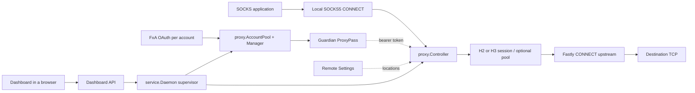

# Architecture and Source Map

Read this for code ownership and call paths. See [sessions](SESSIONS.md) for concurrency, [authentication](AUTHENTICATION.md) for credentials, [multi-account mode](MULTI-ACCOUNT.md) for account failover, [dashboard](DASHBOARD.md) for the web interface, and [configuration](CONFIGURATION.md) for state contracts.

## Packages and dependencies

The module is `github.com/armanlife/firefox-vpn-client/core`. The module root holds only `go.mod`, `go.sum`, and documentation entry points; there is no Go code there. There is no separate Firefox extension, TUN driver, or IPC service.

```text
cmd/firefox-vpn-core/      package main: flags, run modes, one-shot commands (add/list accounts,
                            dashboard login, terminal sign-in); rsrc_windows_*.syso: the icon and
                            version information of the Windows executable
tools/winres/               generator of those .syso files (go generate ./cmd/firefox-vpn-core)
internal/service/           service supervisor (Daemon), proxy engine, dashboard and its API, the
                            API client (Client), dashboard sign-in, DNS test, real-delay orchestration,
                            data paths, local API token
internal/service/web/       dashboard page, styles, script, and flags (go:embed)
internal/proxy/             data plane: accounts bridge (AccountPool), ProxyPass policy, selection,
                            SOCKS5, upstream H2/H3 sessions and pool, controller and renewal, status
                            file, exit probe, connection test, real-delay measurement, HTTP proxy on
                            the SOCKS5 port, routing hook (RoutedOpener), notices
internal/routing/           routing rules, v2ray geosite/geoip lists (read without a protobuf
                            library), in-memory matching, list downloads
internal/desktop/           tray icon, desktop app mode (-app), terminal status screen, Windows
                            system proxy, autostart, notifications, console and single-instance
                            helpers
internal/winsvc/            Windows service: SCM handler, install/uninstall with elevation, query
                            (stubs elsewhere)
internal/logx/              log lines, recent-log hub for the dashboard, daily log files (seven days)
internal/version/           program version (Current) and version comparison
internal/fxa/               Firefox Accounts sign-in, HAWK, OAuth, device record, Fastly challenge
internal/guardian/          Guardian ProxyPass, quota usage, activation, status errors
internal/serverlist/        Remote Settings vpn-serverlist model, record filters, latest Firefox version
internal/accounts/          Multi-account store and failover policy (no network access)
internal/config/            config.json schema, defaults, validation, portable data folder
internal/controlplane/      Shared control-plane HTTP client, cookie jar, and headers
internal/securefile/        Atomic owner-only file writes
internal/resolver/          DNS over HTTPS/TLS/plain for the program's own connections
```

Dependencies point one way: `cmd/firefox-vpn-core` → `desktop` → `winsvc` → `service` → `proxy` → `logx`. `desktop` uses `service` (in-process daemon, API client), `winsvc`, and `proxy` result types; `winsvc` runs a `service.Daemon`; `service` uses `proxy`; these packages log through `logx`, which imports only `securefile`; `version` imports nothing. `proxy` imports `accounts`, `fxa`, `guardian`, `serverlist`, `routing`, and `resolver`; `routing` imports `resolver` and `securefile`; `fxa`, `guardian`, and `serverlist` import only `controlplane` (and `securefile`); `accounts` imports `fxa` for the credential type and `securefile`; `config` imports `guardian` for defaults, `resolver` and `routing` for validation, and `securefile`; `controlplane` imports `resolver`, which imports nothing internal. No internal package imports the CLI. `x/net/http2` implements H2 client sessions and `quic-go`/`http3` H3 sessions, both in `proxy`. Preserve this direction: Go rejects import cycles, so code that two layers need belongs in the lower one.

Each package's tests are white-box tests next to its files. A package exports only what the layers above it use; test helpers are not shared between packages (each test package has its own `helpers_test.go`).

| Concern | Source | Navigation symbols | Tests |
| --- | --- | --- | --- |
| FxA sign-in and OAuth | [fxa.go](../internal/fxa/fxa.go), [signin.go](../internal/fxa/signin.go), [hawk.go](../internal/fxa/hawk.go) | `fxa.Login`, `LoginWithUnblockCode`, `SendUnblockCode`, `VerifySession`, `VerifyTOTP`, `OAuthToken`, `RefreshToken`, `fxaDo` | `fxa_test.go`, `signin_test.go` |
| Account-API challenge | [challenge.go](../internal/fxa/challenge.go) | `solveFastlyChallenge`, `answerChallenge`, `WithCaptchaSolver`, `contextWithMinDeadline` | `challenge_test.go`, `challenge_e2e_test.go` |
| Stored tokens, connected-services device | [tokens.go](../internal/fxa/tokens.go), [device.go](../internal/fxa/device.go) | `SavedTokens`, `RegisterDevice`, `DeviceName` | `device_test.go` |
| Guardian requests | [guardian.go](../internal/guardian/guardian.go) | `FetchProxyPass`, `FetchProxyUsage`, `FetchUserInfo`, `Activate` | `guardian_test.go` |
| ProxyPass claims and time anchoring | [pass.go](../internal/guardian/pass.go) | `ProxyPassInfo`, `anchorProxyPassClaims`, `parseJWTClaims` | `pass_test.go` |
| Quota headers / status classes | [usage.go](../internal/guardian/usage.go), [errors.go](../internal/guardian/errors.go) | `ProxyUsage`, `HTTPError`, `IsTransient`, `RetryAfter`, `UsageFromError` | `usage_test.go`, `errors_test.go` |
| API transport and headers | [controlplane](../internal/controlplane/client.go) | `controlplane.SetTransport`, `Do`, `SetCookies`, `ApplyMozillaVPNHeaders` | Through every client test |
| Server list and filters | [serverlist.go](../internal/serverlist/serverlist.go), [filter.go](../internal/serverlist/filter.go), [version.go](../internal/serverlist/version.go) | `serverlist.Fetch`, `Filter`, `CompareVersions`, `LatestFirefoxVersion` | `filter_test.go`, `version_test.go` |
| Account store and policy | [store.go](../internal/accounts/store.go), [manager.go](../internal/accounts/manager.go), [password.go](../internal/accounts/password.go) | `Store`, `Manager`, `Policy`, `NoUsableAccountError`, `FormatUsage` | `accounts_test.go`, `password_test.go` |
| DNS for the program's own connections | [resolver.go](../internal/resolver/resolver.go), [doh.go](../internal/resolver/doh.go), [network.go](../internal/service/network.go), [dnstest.go](../internal/service/dnstest.go) | `resolver.New`, `Resolver.Lookup`, `resolver.Dial`, `resolver.Set`, `configureDNS`, `Daemon.testDNS` | `resolver_test.go`, `service/dnstest_test.go` |
| Config and data folder | [config.go](../internal/config/config.go) | `Config`, `Load`, `Save`, `DefaultDataDir` | `config_test.go` |
| Flags, run modes, commands | [main.go](../cmd/firefox-vpn-core/main.go), [commands.go](../cmd/firefox-vpn-core/commands.go) | `runCommand`, `runConsole`, `runAddAccount`, `interactiveSignIn` | Checked by hand |
| Data paths, config loading | [paths.go](../internal/service/paths.go) | `service.ResolveDataPaths`, `DataPaths`, `LoadConfig`, `OpenAccounts`, `ReconcileAccountOrder` | `service/paths_test.go` |
| Service supervisor | [daemon.go](../internal/service/daemon.go), [engine.go](../internal/service/engine.go), [listen.go](../internal/service/listen.go) | `Daemon.Run`, `superviseEngine`, `startEngine`, `accountsChanged`, `updateSettings`, `setStateCode`; `listenTCP`, `probeListen`, `AddressInUseError`, `IsAddressInUse` (a taken address, EADDRINUSE or WSAEADDRINUSE) | `service/dashboard_test.go`, `service/listen_test.go` |
| Dashboard and API | [dashboard.go](../internal/service/dashboard.go), [dashboard_api.go](../internal/service/dashboard_api.go), [web/](../internal/service/web/index.html) | `dashboardServer.guard`, handlers | `service/dashboard_test.go` |
| Dashboard sign-in, connection test, logs | [signin_flow.go](../internal/service/signin_flow.go), [conntest.go](../internal/proxy/conntest.go), [loghub.go](../internal/logx/loghub.go) | `signInRegistry`, `proxy.RunConnectionTest`, `logx.Hub`, `logx.Logs` | `service/dashboard_test.go` |
| Local API token and client | [localtoken.go](../internal/service/localtoken.go), [client.go](../internal/service/client.go) | `Daemon.hasLocalToken`, `service.Client`, `TrayStatus.StatusLines` | `service/localtoken_test.go`, `service/client_test.go` |
| Logging, log file | [log.go](../internal/logx/log.go), [file.go](../internal/logx/file.go), [open_windows.go](../internal/logx/open_windows.go) | `logx.Info`, `logx.Err` (redacts errors that implement `Redacted`), `dailyFile`, `pruneLogs`, `logx.EnableFile` | `logx/file_test.go`, `proxy/redact_test.go` |
| Account failover bridge | [accounts.go](../internal/proxy/accounts.go) | `AccountPool.AcquirePass`, `Record`, `Relogin`, `observeActiveUsage` | `proxy/accounts_test.go`, `service/relogin_test.go` |
| ProxyPass acquisition policy | [proxypass.go](../internal/proxy/proxypass.go), [auth.go](../internal/proxy/auth.go) | `fetchProxyPassCtx`, `recoverGuardianRejection`, `runtimeAuth`, `FreshRuntimeAuth` | `proxypass_test.go` |
| Selection and persisted choice | [selection.go](../internal/proxy/selection.go) | `ResolveWithStateAndCountry`, `selectProxyCandidate`, `Candidate` | `selection_test.go` |
| SOCKS and forwarding | [socks.go](../internal/proxy/socks.go), [relay.go](../internal/proxy/relay.go) | `ServeSOCKS`, `SOCKSServer`, `handshakeSOCKS5`, `proxyBidirectional` | `socks_test.go`, `socks_auth_test.go`, `relay_test.go` |
| Routing | [router.go](../internal/routing/router.go), [region.go](../internal/routing/region.go), [geodat.go](../internal/routing/geodat.go), [match.go](../internal/routing/match.go), [update.go](../internal/routing/update.go), [route.go](../internal/proxy/route.go), [service/routing.go](../internal/service/routing.go) | `routing.New`, `routing.RegionRules`, `routing.SwapRegionRules`, `routing.FilesFor`, `Router.Decide`, `DomainSet`, `IPSet`, `routing.Download`, `proxy.RoutedOpener`, `Daemon.applyRouting`, `runRoutingUpdates` | `routing_test.go`, `proxy/route_test.go`, `service/routing_test.go` |
| HTTP proxy on the SOCKS5 port | [http_proxy.go](../internal/proxy/http_proxy.go) | `serveHTTP`, `openTarget`, `bufferedConn`, `matchBasic` | `http_proxy_test.go` |
| Windows system proxy | [sysproxy.go](../internal/desktop/sysproxy.go), [sysproxy_windows.go](../internal/desktop/sysproxy_windows.go) | `systemProxySync.update`, `setSystemProxy`, `restoreSystemProxy`, `clearSystemProxy` | `desktop/sysproxy_windows_test.go` |
| Speed and transferred bytes | [traffic.go](../internal/proxy/traffic.go) | `trafficMeter`, `countConn`, `RoutedOpener.Traffic` | `TestTrafficCountsBytesAndSpeed` |
| Destination test | [service/routing.go](../internal/service/routing.go), [router.go](../internal/routing/router.go) | `handleRoutingTest`, `splitTarget`, `Router.Explain` | `TestDestinationTest` |
| Waiting for a network | [netstate](../internal/netstate), [daemon.go](../internal/service/daemon.go) | `netstate.Connected` (Windows: `GetAdaptersAddresses`, an adapter up with a gateway; Linux: `/proc/net/route`, `/proc/net/ipv6_route`), `Daemon.mustWaitForNetwork`, `waitForNetwork` | `TestEngineWaitsForNetwork`, `TestEngineIgnoresNetworkWhenOff`, `TestWindowsAdapters`, `TestLinuxDefaultRoutes` |
| Lazy start and sleeping when unused | [sleep.go](../internal/service/sleep.go), [engine.go](../internal/service/engine.go) | `idleState`, `Daemon.useController` (wakes once for many connections; `wakeReason`, `wakeRetryCooldown`), `wake`, `connectEngine` (first wake), `reconnectEngine`, `registerDevices`, `sleepIfIdle`, `engineUpstream`, `releasingConn`, `runController`, `expectedSelection`, `proxy.WriteIdleStatus` | `TestEngineStartsAsleepAndConnectsOnFirstUse`, `TestConnectionTestWakesProxy`, `TestFailedWakeWaitsBeforeRetrying`, `TestIdleSleepAndWake`, `TestIdleSleepOff`, `TestReleasingConnKeepsHalfClose` |
| Automatic connection test | [dashboard_api.go](../internal/service/dashboard_api.go), [renewal.go](../internal/proxy/renewal.go) | `Daemon.autoTest`, `runConnectionTest`, `Controller.OnSessionRebuilt` | `TestSessionRebuildIsReported` |
| Public IP (exit probe) | [exitprobe.go](../internal/proxy/exitprobe.go) | `VerifyExit` (IPv4 and IPv6 at once), `askFamily`, `parseExitProbeResponse` | `exitprobe_test.go` |
| Session contracts, tunnels | [session.go](../internal/proxy/session.go), [tunnel.go](../internal/proxy/tunnel.go) | `proxySession`, `sessionFailureTracker`, `tunnelConn` | `session_test.go`, `tunnel_test.go` |
| Upstream transports and pool | [upstream_h2.go](../internal/proxy/upstream_h2.go), [upstream_h3.go](../internal/proxy/upstream_h3.go), [pool.go](../internal/proxy/pool.go) | `h2ProxySession`, `h3ProxySession`, `proxySessionPool` | `upstream_test.go`, `pool_test.go` |
| Controller, renewal, status | [controller.go](../internal/proxy/controller.go), [renewal.go](../internal/proxy/renewal.go), [status.go](../internal/proxy/status.go) | `proxy.Controller`, `RunRenewalLoop`, `checkQuota`, `SwitchAccountNow`, `writeStatusFile` | `controller_test.go`, `renewal_test.go`, `status_test.go` |
| Real delay (latency), fastest server | [proxy/ping.go](../internal/proxy/ping.go), [service/ping.go](../internal/service/ping.go) | `PingLocations`, `TunnelMeter`, `MergePings`, `FastestLocation`, `Daemon.PingAll`, `resolveFastestCountry` | `proxy/ping_test.go`, `service/ping_test.go` |
| Terminal status screen | [console_ui.go](../internal/desktop/console_ui.go) | `desktop.RunConsole`, `consoleBackend` (`daemonBackend`, `apiBackend`), `normalizeKey`, `fitWidth` | `desktop/console_ui_test.go` |
| Version | [version.go](../internal/version/version.go) | `version.Current`, `version.Newer` | `version/version_test.go` |
| Tray icon | [tray.go](../internal/desktop/tray.go) (Windows, Linux), [trayicon.go](../internal/desktop/trayicon.go), [tray_other.go](../internal/desktop/tray_other.go) | `desktop.RunTray`, `trayApp.refresh`, `trayApp.startOwn`, `trayIcon` (the icons in `internal/desktop/tray`, made by `app/tool/app_icons.py`) | `desktop/trayicon_test.go`; menu checked by hand |
| Desktop app mode (`-app`) and code shared with the tray | [app.go](../internal/desktop/app.go), [host.go](../internal/desktop/host.go) | `desktop.RunApp`, `runHosted`, `watchParent`, `stdinIsPipe`, `ErrAlreadyRunning`, `ReportAppError` (the `app-error:` line and exit status), `newHostedDaemon`, `pollStatus`, `systemProxySync.follow`, `Daemon.RequireDashboard` | `desktop/app_test.go`, `cmd/firefox-vpn-core/main_test.go`, `TestRequireDashboardRefusesDisabledDashboard` |
| Windows service, elevation | [service_windows.go](../internal/winsvc/service_windows.go), [service_other.go](../internal/winsvc/service_other.go) | `windowsService.Execute`, `winsvc.Install`, `doInstallService`, `grantServiceAccess`, `winsvc.QueryFor`, `shellExecuteRunAs` | `desktop/platform_windows_test.go` (query only) |
| Autostart, console, notifications, single instance | [platform_windows.go](../internal/desktop/platform_windows.go), [platform_other.go](../internal/desktop/platform_other.go) | `desktop.SetAutostart`, `StartedWithOwnConsole`, `DetachConsole`, `acquireSingleInstance`, `registerNotificationApp`, `notify`, `openBrowser` | `desktop/platform_windows_test.go`, `desktop/platform_other_test.go` |
| Linux service | [install-systemd.sh](../scripts/install-systemd.sh) | `cmd_install`, `write_unit` | Not executed in the Windows audit |

## Traffic paths



The shared control-plane client serves FxA, Guardian, Remote Settings, the geo files, and flags; the user's own relay, `network.api_relay` (a Cloudflare Worker or a PHP file, [scripts/relay](../scripts/relay)) can carry its requests (`relayTransport`). H2/H3 sessions create their own data-plane connections. Fastly challenge handling applies to the account API only.

## Service lifecycle

1. `main` parses the flags; `runCommand` resolves the data folder (next to the executable) and either runs a one-shot command or one of the run modes: the Windows service (`-service`, or started by the Service Control Manager) runs the daemon through `windowsService.Execute` (`internal/winsvc`); the tray (`-tray`; started by the sign-in Run key it also closes its console) runs `trayApp` (`internal/desktop`), which uses the daemon of another process through `service.Client` when one answers, and otherwise runs the daemon itself; the desktop app mode (`-app`) runs the daemon itself with no tray icon or status screen (`desktop.RunApp`), logs to the file only, applies the system proxy mode like the tray, and stops on `POST /api/app/exit`, Ctrl+C, SIGTERM, or the end of its standard input pipe (the app that started it quit); any other start in an interactive terminal shows the status screen (`desktop.RunConsole`): on Windows it starts the tray in the background when nothing serves the folder (`spawnTray`) and only controls it through `service.Client`, so closing the window never stops the proxy; elsewhere it runs the daemon itself; a non-interactive start or `-plain` runs the daemon with the plain log (`runConsole`) until Ctrl+C or SIGTERM.
2. `service.NewDaemon` loads or creates `config.json`, applies process-wide settings (log level, locked locations, API relay), opens the account store reconciles the account order, and builds the account manager and pool.
3. `Daemon.Run` creates the local API token, starts the dashboard (fatal if its address is unavailable), publishes the token to `local-api.token`, then `superviseEngine` loops until `Daemon.Shutdown` (service stop, Ctrl+C, tray quit, app-mode stop) closes the stop channel; `run` then stops the engine and the dashboard and returns:
   - Network wait (always): while `netstate.Connected` reports no network, the state is "Waiting for a network connection" and nothing is started; the adapters are read again every two seconds (`networkPoll`). A start that fails while the network goes away waits again instead of reporting an error.
   - `startEngine` sends nothing over the network: it listens on `proxy.listen` (a taken address fails at once), requires an enabled account and, from the local account state, one that is usable (`Manager.Candidate`), and starts the SOCKS5/HTTP server on an engine that is asleep (no controller, `sleeping_since` set, `status.json` reason `sleeping`). The phase is `running`, so the tray and the app mode apply `system_proxy.mode` `set` at once.
   - First wake (`Daemon.wake` → `connectEngine`), when a client connection through Mozilla, a connection test, or a real-delay test needs the upstream; the caller waits for it: fetches the server list (with the latest Firefox version) while obtaining a pass with `AccountPool.AcquirePass`; resolves `fastest` with that pass; selects the upstream; creates the controller and its first H2/H3 session; starts renewal and quota monitoring; then runs the automatic connection test with the public IP check (not when the wake was the connection test itself) and registers the accounts' devices once per run (`registerDevices`). Later wakes after `proxy.idle_sleep` reuse the server (`reconnectEngine`). A failed wake leaves the engine asleep and shows `wake_error`; client connections get that error for `wakeRetryCooldown` (10 seconds) instead of contacting Mozilla again, while tests and real-delay measurements retry at once; "no usable account" restarts the engine so the state shows the wait.
   - Running: waits for a restart request (settings change, Restart proxy, or an account change while stopped), then stops the engine (listener and sessions) and starts again.
   - Failed start: waits until an account is added, until the earliest quota reset when every account is reserved, or 30 seconds for other errors (5 seconds within 30 seconds of a network connecting, while DNS and DHCP settle; each shortened by a restart request).
4. Account changes from the dashboard reload the manager in place; a running engine switches accounts with `Controller.SwitchAccountNow` (in-place token update) only when the active account was removed, disabled, or explicitly replaced.

## Runtime interfaces

| Interface | Contract |
| --- | --- |
| `tunnelOpener` | `OpenTunnel(authority string) (net.Conn, error)` |
| `proxySession` | A tunnel opener with `Close() error` |
| `clientAffinityTunnelOpener` | Optional `OpenTunnelForClient(authority, clientKey string)` |
| `proxySessionTokenUpdater` | Optional `UpdateToken(token string) error` |
| `proxySessionLivenessChecker` | Optional `IsAlive() bool` |

The SOCKS server and the connection test use the opener contract. The controller handles credential expiry, admission, retry, and reference lifetimes. A session supplies multiplexed CONNECT streams. A pool implements a session while managing several underlying sessions.

These optional interfaces matter when adding an implementation: missing token update can lead to session replacement; missing liveness information uses the existing reactive failure path. Test through the controller as well as the transport constructor.

## Boundaries for changes

- Keep upstream connection logic out of the internal control-plane packages.
- The tray and the status screen's client mode never touch accounts or the engine directly; it uses the dashboard API (`service.Client`) so it works the same against a service in another process.
- Keep platform code behind build tags (`*_windows.go`, `*_other.go`, tray for `windows || linux`) so Linux and macOS builds need no CGO.
- Keep account selection and refresh decisions out of byte-copy loops; tunnels only count bytes (`noteTraffic`).
- Keep SOCKS target failure separate from session-wide failure classification.
- Persist configuration and account metadata without persisting the ProxyPass; keep credentials only in `accounts/<id>/credentials.json`.
- Keep all data in the data folder next to the executable (`user-data`); the only other location is the desktop app's data folder, used when the core sits beside the app.
- The dashboard must stay usable while the proxy is stopped; do not make dashboard handlers depend on a running engine except the connection test.
- No direct-dial fallback when Mozilla fails, UDP ASSOCIATE, BIND, TUN, or system routing exists. Connections go directly only to destinations the opt-in routing rules name (`routing.enabled`, off by default); the connection test, the public IP check, and list downloads through the proxy always use Mozilla (`Controller`, not `RoutedOpener`).
- The proxy engine runs when the accounts allow it and it is not switched off (`POST /api/power`; the desktop app's `-app` core and the Android app start off, until the user connects). Running means listening: it contacts Mozilla (Remote Settings, Guardian, FxA, the upstream) only once something needs the upstream (first wake); the dashboard's location list (`GET /api/locations`) and sign-in are the other requests, made only when asked. The Windows system proxy is applied only by the tray or the app mode in the user's session (the service cannot change the user's settings), in one of two modes: Set only while the proxy runs, with the previous setting restored afterwards, or Clear once.

Use the recipes in [CHANGE-GUIDE.md](CHANGE-GUIDE.md) to find the complete edit surface for a requested feature.
