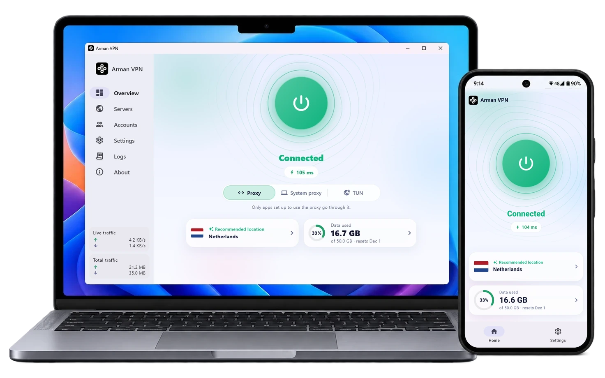
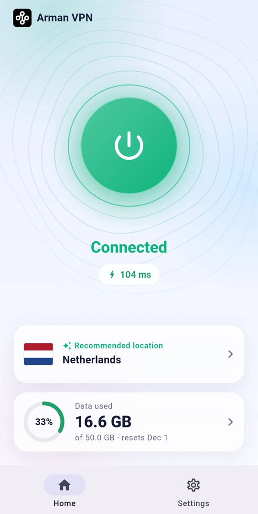
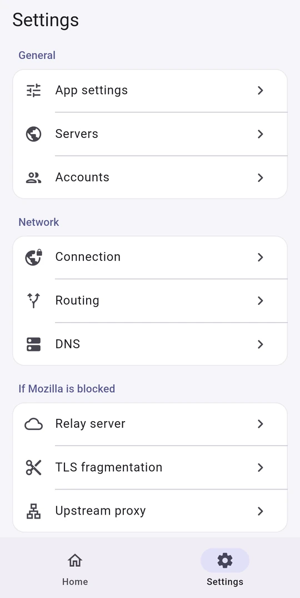
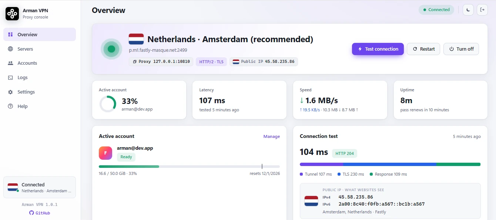

<div align="center">

[🇺🇸 English](../../README.md) &nbsp;/&nbsp; [🇮🇷 فارسی](README_fa.md) &nbsp;/&nbsp; **🇨🇳 简体中文** &nbsp;/&nbsp; [🇷🇺 Русский](README_ru.md)

</div>
<br>

<p align="center"></p>

<h1 align="center">Arman VPN</h1>

<h2 align="center">⚠️ 非官方项目</h2>

<h3 align="center">Arman VPN 是一个独立项目，并非由 Mozilla 开发、拥有、赞助或认可，与 Mozilla 没有任何关联。参见<a href="#免责声明">免责声明</a>。</h3>

<div align="center">

[](https://github.com/armanlife/arman-vpn-client/releases)
[](https://github.com/armanlife/arman-vpn-client/releases/latest)
[](../../LICENSE)

</div>

## Arman VPN 是什么？

**Arman VPN** 是一款免费、开源的 VPN，使用 Firefox 账户（Firefox Account）登录。它通过 Mozilla 的服务器，基于 **Fastly** 的基础设施，以安全的 **HTTP/2 和 HTTP/3** 隧道传输你的网络流量。

支持 **Android、Windows、macOS 和 Linux**；完全免费，没有广告。

<p align="center"><a href="https://raw.githubusercontent.com/armanlife/arman-vpn-client/main/docs/screenshots/main.webp" target="_blank"></a></p>

## 🚀 主要功能

✈️ 跨平台：Android、Windows、macOS 和 Linux

📺 Android TV：支持遥控器操作

⭐ 界面简洁，非常易用

🆓 免费：每个 Firefox 账户每月 50 GB

🌐 Mozilla 服务器：通过延迟测试选择国家，或自动选择最佳服务器

⚡ 基于 HTTP/2 和 HTTP/3 的快速、稳定连接

🔀 智能分流（Split Tunneling）：选择不通过 VPN 的网站和应用

🧱 如果你的网络封锁了连接：TLS 分片、上游 SOCKS5 代理和中继服务器

🔒 加密 DNS（DNS over HTTPS）

🌍 支持 15 种语言，包括英语、波斯语、中文和俄语

🌙 浅色和深色主题

🛡 开源、安全、社区驱动

🔄 自动更新

## 📸 截图

<p align="center">
&nbsp;&nbsp;
&nbsp;&nbsp;

</p>

## 📥 下载

<table>
<thead>
<tr><th>系统</th><th>下载</th></tr>
</thead>
<tbody>
<tr><td>Android</td><td><a href="https://github.com/armanlife/arman-vpn-client/releases/latest/download/Arman-VPN-Android-universal.apk"></a><br><a href="https://github.com/armanlife/arman-vpn-client/releases/latest/download/Arman-VPN-Android-arm64-v8a.apk"></a><br><a href="https://github.com/armanlife/arman-vpn-client/releases/latest/download/Arman-VPN-Android-armeabi-v7a.apk"></a><br><a href="https://github.com/armanlife/arman-vpn-client/releases/latest/download/Arman-VPN-Android-x86_64.apk"></a></td></tr>
<tr><td>Android TV</td><td><a href="https://github.com/armanlife/arman-vpn-client/releases/latest/download/Arman-VPN-Android-universal.apk"></a></td></tr>
<tr><td>Windows</td><td><a href="https://github.com/armanlife/arman-vpn-client/releases/latest/download/Arman-VPN-Windows-Setup-x64.exe"></a><br><a href="https://github.com/armanlife/arman-vpn-client/releases/latest/download/Arman-VPN-Windows-x64.zip"></a></td></tr>
<tr><td>macOS</td><td><a href="https://github.com/armanlife/arman-vpn-client/releases/latest/download/Arman-VPN-macOS.dmg"></a></td></tr>
<tr><td rowspan="2">Linux</td><td><a href="https://github.com/armanlife/arman-vpn-client/releases/latest/download/Arman-VPN-Linux-amd64.tar.gz"></a><br><a href="https://github.com/armanlife/arman-vpn-client/releases/latest/download/Arman-VPN-Linux-arm64.tar.gz"></a></td></tr>
<tr><td><a href="https://github.com/armanlife/arman-vpn-client/releases/latest/download/arman-vpn-core-linux-amd64.tar.gz"></a><br><a href="https://github.com/armanlife/arman-vpn-client/releases/latest/download/arman-vpn-core-linux-arm64.tar.gz"></a></td></tr>
</tbody>
</table>

**该下载哪个文件？**

- **Android：** 不确定的话，选 **Universal**，所有手机都能安装。**ARMv8** 适用于大多数现代手机，体积更小。
- **Windows：** **Setup** 是普通安装程序；**Portable** 无需安装，可在任意文件夹运行。
- **Linux：** **App** 用于 Linux 桌面（有图形界面）；**Core** 用于服务器（无图形界面，带网页面板）。

## 💻 在 Linux 和 macOS 上安装与更新

> Windows 和 Android 用户无需阅读本节：直接从上方“下载”表格获取安装文件。

```bash
curl -fsSL https://raw.githubusercontent.com/armanlife/arman-vpn-client/main/install.sh | bash
```

### 🌐 网页面板

在 Linux 服务器上，Arman VPN 提供一个**网页面板**，可在任何浏览器中打开，拥有应用的全部功能：管理账户和流量、选择服务器并测试延迟、连接测试、实时日志以及所有设置。

<p align="center"></p>

- **面板地址：** `http://SERVER-IP:10820/app/`，需要用户名和密码。安装结束时会显示确切地址。
- **代理：** 端口 `10810` 上的 SOCKS5 和 HTTP，使用单独的用户名和密码。

### ⌨️ 在终端中管理

在服务器上运行 `sudo arman-vpn`，即可打开管理菜单：

```text
$ sudo arman-vpn

  Arman VPN
  ────────────────────────────────────────────────────────────────────────────
    Service     ● running
    Autostart   on
  ────────────────────────────────────────────────────────────────────────────
   0) Exit
  ────────────────────────────────────────────────────────────────────────────
   1) Update                                   arman-vpn update
   2) Uninstall                                arman-vpn uninstall
  ────────────────────────────────────────────────────────────────────────────
   3) Set panel login                          arman-vpn panel
   4) View panel info                          arman-vpn panel-info
  ────────────────────────────────────────────────────────────────────────────
   5) Status                                   arman-vpn status
   6) Start                                    arman-vpn start
   7) Stop                                     arman-vpn stop
   8) Restart                                  arman-vpn restart
   9) Show the log                             arman-vpn logs
  ────────────────────────────────────────────────────────────────────────────
  10) Enable autostart                         arman-vpn enable
  11) Disable autostart                        arman-vpn disable
  ────────────────────────────────────────────────────────────────────────────
  12) Add a Firefox Account                    arman-vpn add-account
  13) List the accounts                        arman-vpn list-accounts
  ────────────────────────────────────────────────────────────────────────────
  Enter a number [0-13]:
```

## OpenWrt 路由器

如需在 OpenWrt 路由器上安装，请参阅 [OpenWrt 指南](../OPENWRT.md)。

## 免责声明

本应用是一个独立的非官方客户端，由其开发者自行开发和维护。它不是 Mozilla 的产品：Mozilla 没有开发它，不拥有、不赞助、也不认可它，也不参与它的开发或支持。有关本应用的问题请在本仓库提出，而不是向 Mozilla 反映。

你使用自己的 Mozilla 账户登录。账户的条款、流量限额和可用性由 Mozilla 决定。你的密码和登录令牌只保存在你的设备上。
